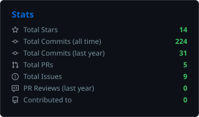
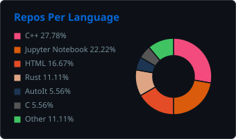
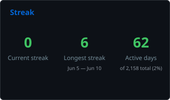
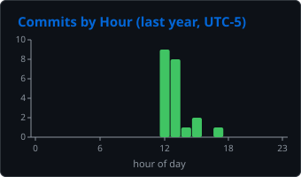

<!--
  ⚡ Profile README for makt96
  Stats are generated by GitHub Actions (ghstats) and committed as SVGs
  under /output/github_dark/. The "Currently Working With" section is
  dynamically updated by readme-engine (WakaTime plugin).
  No external Vercel endpoints. No rate limits. No expiration.
-->

<h1 align="center">Hi, I'm MD 👋</h1>

  <em>Data Engineer · Backend Engineer · System design enthusiast · Open-source contributor</em>

  I build reliable data pipelines, clean architectures, and developer tools that stay out of the way.

  
  
  

---

### 🧭 What I'm about

- 🔭 Currently building **event-driven data platforms** and **internal developer tooling**.
- 🌱 Working on building Scaleable, Robust, Cost-Optimized **Data Pipeline** on cloud infrastructure
- 💬 Ask me about **Python, SQL, System Design, Snowflake, dbt, Spark, Databricks, Airflow, Kafka, and clean API design**.
- ⚡ I believe good documentation is a feature, not an afterthought.

---

### 💼 Currently Working With

<!--START_SECTION:waka-->
<!--END_SECTION:waka-->

---

### 🛠️ Tech Stack

**Languages & Core**

  
  
  
  

**Data Engineering**

  
  
  
  
  
  

**Infrastructure & Tools**

  
  
  
  
  
  
  
  

---

### 📊 GitHub, in numbers

  
  

  
  

---

### 🚀 Selected Projects

| Project | What it does | Stack |
| :--- | :--- | :--- |
| **[project-1](https://github.com/makt96/btc-pipeline)** | One-line summary of the problem this solves. | `Python` · `Airflow` · `Snowflake` |
| **[project-2](https://github.com/makt96/project-2)** | One-line summary of the problem this solves. | `dbt` · `Spark` · `Databricks` |
| **[project-3](https://github.com/makt96/project-3)** | One-line summary of the problem this solves. | `Go` · `Kafka` · `PostgreSQL` |
| **[project-4](https://github.com/makt96/project-4)** | One-line summary of the problem this solves. | `Python` · `Docker` · `AWS` |

> *Replace the `project-*` links and descriptions with your actual repositories.*

---

### 👁️ Profile views

  

---

  <em>Thanks for stopping by. If something here resonates, my inbox is always open. 
MAKT.CSE@GMAIL.COM</em>

